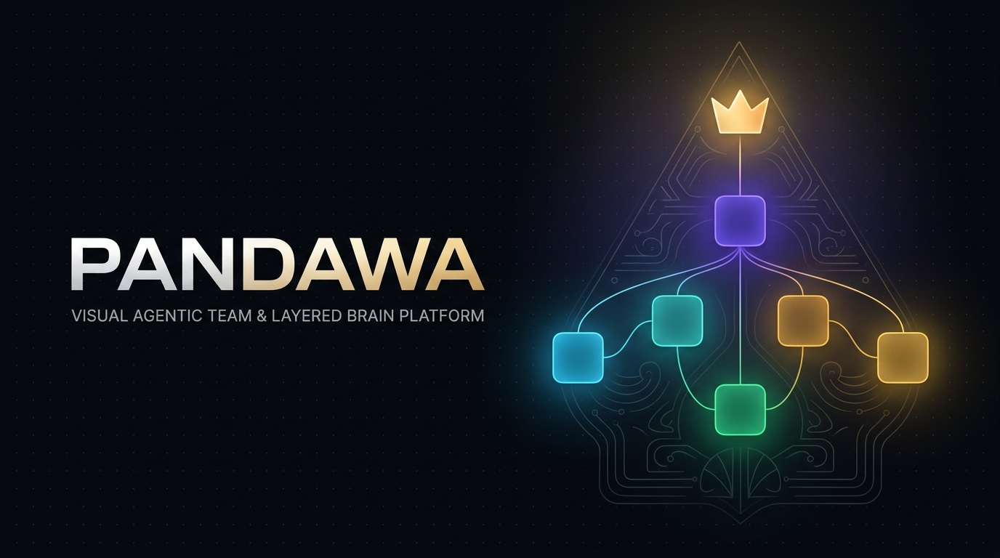

<p align="center">
  
</p>

<h1 align="center">PANDAWA ⚡</h1>

<p align="center">
  <strong>Visual Agentic Team & Layered Brain Platform with Multi-AI Routing</strong>
</p>

<p align="center">
  <a href="https://github.com/be-yourself-never-surrender/pandawa/releases"></a>
  <a href="LICENSE"></a>
  
  
  
  
</p>

---

**Pandawa** is a clean-room, self-hosted **Agentic Team Platform** built from scratch in TypeScript (~28 MB RAM footprint, zero external agent boilerplate, ready for commercial use). Inspired by the Javanese legend of the **Pandawa Lima** (*Yudhistira, Bima, Arjuna, Nakula, Sadewa*), Pandawa connects multiple AI providers and models into **one cohesive peer team** wired visually through layered brains.

Unlike rigid top-down orchestrators, disposable sub-agents, or stateless swarms, Pandawa agents collaborate **horizontally as persistent teammates** through a shared **Main Brain**, **Team/Group Brain**, custom knowledge folders (`soul.md`, `rules.md`, `memory.md`, `SKILL.md`), a live **Team Blackboard**, a **Shared Task Board**, and dynamic peer-to-peer consultation (`consult_teammate`).

Bring **any AI model from any provider** — OpenAI, Anthropic, Google Gemini, DeepSeek, Groq, xAI, Mistral, OpenRouter, local Ollama/vLLM, or **any Custom Base URL** — and assign different models to different teammates in the same squad based on purpose.

<table>
<tr><td><b>Visual Brain & Team Canvas (n8n-Style)</b></td><td>Drag, drop, and wire <b>Main Brains</b>, <b>Team Brains</b>, <b>Agents</b>, <b>AI Models</b>, <b>Files/Folders (<code>soul.md</code>)</b>, and <b>Toolpacks</b>. Edges control live runtime context &amp; read/write/sync permissions. Active nodes pulse live while thinking, plus <b>1-Click Team Kits</b> &amp; team-clustered auto-layout.</td></tr>
<tr><td><b>True Agentic Team (Musyawarah)</b></td><td>Four peer collaboration modes (<b>Deliberate + Cross-Review</b>, <b>Parallel Co-Execution</b>, <b>Sequential Relay</b>, <b>Rapid Council</b>), a live <b>Team Blackboard</b>, a <b>Shared Team Task Board</b>, and mid-turn <code>consult_teammate</code> calls.</td></tr>
<tr><td><b>Layered Brains & Closed Learning Loop</b></td><td>Composable filesystem + native <b>SQLite FTS5</b> indexing across <b>Main Brain → Team Brain → Personal Brain</b>. Agents autonomously distill reusable <code>SKILL.md</code> playbooks, persist episodic memories, and recall past conversations via <code>session_search</code>.</td></tr>
<tr><td><b>32 Built-In Power Tools + Live MCP</b></td><td>Surgical file patching, workspace grep &amp; snapshot rollbacks, Python/Node/Bash code runner, persistent background process manager, zero-key web search, full REST/GraphQL client, browser extraction/screenshots, self-scheduling cron, and live <b>HTTP/SSE + STDIO MCP</b> client.</td></tr>
<tr><td><b>Multi-AI Routing & AES-256 Vault</b></td><td>Mix Official APIs and Custom Base URLs per teammate with live SSE token streaming, Anthropic prompt caching, exponential retry (<code>429</code>/<code>5xx</code>), automatic backup provider fallback, token analytics, and <b>AES-256-GCM</b> encrypted API keys.</td></tr>
<tr><td><b>Built for Freedom (Approval Gate Only)</b></td><td>Zero hidden censorship or command blocklists. Choose between <b>Auto (Full Freedom)</b>, <b>Approve Shell Only</b>, <b>Approve Sensitive</b>, or <b>Approve All</b> with a live floating popup (<b>Approve / Auto All / Reject</b>) and instant <b>Stop Mission</b> abort control.</td></tr>
<tr><td><b>Commercial Brain Kits (<code>.pandawa.json</code>)</b></td><td>Package any Team + Brains + <code>soul.md</code>/skills + Canvas wiring into a portable template (API keys automatically stripped) with a built-in <b>Preview Modal</b> before install — ready to sell or share.</td></tr>
<tr><td><b>Web Studio + Terminal CLI + Live Bots</b></td><td>Run the full Web Studio on any VPS (<code>IP:7777</code> or auto-HTTPS via Caddy), use the native <code>pandawa</code> CLI (<code>chat</code>, <code>status</code>, <code>doctor</code>, <code>backup</code>), or talk to your squad 2-way from <b>Telegram</b>, <b>Discord</b>, and <b>Webhooks</b>.</td></tr>
</table>

---

## System Architecture

```text
┌────────────────────────────────────────────────────────────────────────────┐
│                           Entry Points                                     │
│  Web Studio (React + React Flow)   ·   CLI (`pandawa`)   ·   Cron Daemon   │
│  2-Way Telegram Bot Poller         ·   Discord / Inbound & Outbound Hooks  │
└────────────────────────────────────┬───────────────────────────────────────┘
                                     ▼
┌────────────────────────────────────────────────────────────────────────────┐
│                     Pandawa Brain-Graph Compiler                           │
│   [Main Brain] ──▶ [Team / Group Brain] ──▶ [Custom Folders / soul.md]     │
│        + SQLite FTS5 Memories + Past Session Recall + Team Blackboard      │
└────────────────────────────────────┬───────────────────────────────────────┘
                                     ▼
┌────────────────────────────────────────────────────────────────────────────┐
│                Agentic Team Engine (Musyawarah & Eksekusi)                 │
│  ┌──────────────┐  ┌──────────────┐  ┌──────────────┐  ┌──────────────┐   │
│  │  Yudhistira  │◀▶│     Bima     │◀▶│    Arjuna    │◀▶│Nakula/Sadewa │   │
│  │   Strategy   │  │  Execution   │  │    Coding    │  │ Research/QA  │   │
│  └──────┬───────┘  └──────┬───────┘  └──────┬───────┘  └──────┬───────┘   │
│         ▼                 ▼                 ▼                 ▼            │
│   Anthropic API      OpenAI API        DeepSeek API     Gemini / Custom    │
│      (SSE Streaming + Prompt Caching + Retry + Backup Fallback + Abort)    │
└────────────────────────────────────┬───────────────────────────────────────┘
                                     ▼
┌────────────────────────────────────────────────────────────────────────────┐
│         User Approval Gate (Auto / Approve) & 8 Power Toolpacks            │
│  Brain/FTS5 · Team/Tasks · Workspace/Patch/Checkpoint · Shell/Code/Procs   │
│  Web Search/HTTP · Browser Extract/Shot · Cron/Channels · HTTP/STDIO MCP   │
└────────────────────────────────────────────────────────────────────────────┘
```

---

## Quick Install

### Linux, macOS, WSL2 (1-Line Installer)

```bash
curl -fsSL https://raw.githubusercontent.com/be-yourself-never-surrender/pandawa/main/scripts/install.sh | bash
```

### Windows (PowerShell)

```powershell
iex (irm https://raw.githubusercontent.com/be-yourself-never-surrender/pandawa/main/scripts/install.ps1)
```

### Docker Compose (Self-Hosted / Production)

```bash
git clone https://github.com/be-yourself-never-surrender/pandawa.git
cd pandawa
docker compose up -d --build
```

### Manual Source Build (Node.js 22+ / Recommended v24 LTS)

```bash
git clone https://github.com/be-yourself-never-surrender/pandawa.git
cd pandawa
npm install
npm --prefix web install
npm run build
PANDAWA_PORT=7777 npm start
```

Open **`http://localhost:7777`** (or **`http://<VPS_IP>:7777`**) and sign in with the default password **`11111111`**, then immediately change your password under **Settings & VPS → Change Admin Password**.

---

## CLI & Web Studio Quick Reference

### Terminal CLI Commands

```bash
pandawa start                 # Start Web Studio & API server (default port 7777)
pandawa chat                  # Interactive terminal session with Team Pandawa
pandawa chat "Audit our API"  # One-shot team mission from terminal
pandawa status                # Inspect Brains, Teams, Agents, Providers, Skills & Tools
pandawa doctor                # Verify Node.js, SQLite FTS5, Vault, RAM & paths
pandawa approval auto         # Switch Approval Gate (auto | approve_shell | approve_sensitive | approve_all)
pandawa backup kit.json       # Export full Team + Brain Kit backup (.pandawa.json)
```

### Mission Room & CLI Slash Commands + `@file` References

| Command / Syntax | Description |
| --- | --- |
| `@main-brain/soul.md` | Inject any Brain file inline directly into your mission prompt |
| `/new` | Start a fresh Mission session |
| `/mode deliberate` | Switch team mode (`deliberate`, `parallel`, `sequential`, `consensus`) |
| `/auto` | Switch Approval Gate to **Auto (Full Freedom)** immediately |
| `/approve` | Switch Approval Gate to **Approve Shell Only** |
| `/tasks` | Open the live **Shared Team Task Board** panel |
| `/processes` | Open the live **Managed Background Processes** & logs panel |
| `/agent <name>` *(CLI)* | Talk directly to a single specialist agent (e.g., `/agent arjuna`) |
| `/team` *(CLI)* | Switch back to full Agentic Team mode |

---

## Complete Tool Arsenal (32 Built-In Tools + Live MCP)

| Toolpack | Included Tools |
| --- | --- |
| **`brain`** | `brain_search`, `brain_list`, `brain_read`, `brain_write`, `remember_fact`, `learn_skill`, `session_search` (FTS5 cross-session recall) |
| **`team`** | `blackboard_post`, `blackboard_read`, `consult_teammate` (dynamic peer call), `team_todo_manage` (shared task board) |
| **`workspace`** | `workspace_list`, `workspace_read`, `workspace_write`, `workspace_patch` (surgical edit), `workspace_grep`, `checkpoint_create`, `checkpoint_rollback` |
| **`shell`** | `shell_exec` (unrestricted, user-approved), `code_execute` (Python / Node.js / Bash), `process_start`, `process_list`, `process_logs`, `process_kill` |
| **`web`** | `web_search` (zero-key DuckDuckGo + optional Tavily), `web_fetch`, `http_request` (full REST/GraphQL client) |
| **`browser`** | `browser_extract` (title, headings, links & clean DOM text), `browser_screenshot` (headless Chromium PNG capture) |
| **`automation`** | `cron_create`, `cron_list`, `channel_notify` (proactive Telegram / Discord / Webhook alerts) |
| **`mcp` (Dynamic)** | Auto-discovers & invokes tools from any connected **HTTP/SSE** or **Local STDIO** MCP server (`mcp__<server>__<tool>`) |

---

## Multi-AI Provider Support

Configure unlimited providers inside **Multi-AI Hub** (encrypted at rest via **AES-256-GCM**) and bind any model to any Agent on the Brain Canvas:

| Protocol (`kind`) | Supported Providers & Endpoints |
| --- | --- |
| **`openai`** | OpenAI Official, DeepSeek, Groq, xAI, Mistral, OpenRouter, Ollama, vLLM, LM Studio, LiteLLM, **any Custom Base URL** |
| **`anthropic`** | Anthropic Official (`api.anthropic.com`) with ephemeral prompt caching, or Anthropic-compatible proxies |
| **`gemini`** | Google Gemini Native API (`generativelanguage.googleapis.com/v1beta`) with SSE streaming |

---

## Commercial Brain Kits (`.pandawa.json`)

Pandawa is built so teams, agencies, and creators can package and sell reusable AI organizations:

1. Build your specialized **Main Brain**, **Team Brain**, `soul.md` / `rules.md` / `SKILL.md` folders, and agent topology on the **Brain Canvas**.
2. Click **Export Kit** (on the Canvas toolbar or in **Settings & VPS**) to download a clean `.pandawa.json` bundle — **all API keys and secrets are automatically excluded**.
3. Recipients click **Import Kit**, inspect all included Brains, Agents, and files in the **Brain Kit Preview Modal**, and install the entire squad cleanly in 1 click.

---

## Production Deployment with Auto-HTTPS (Caddy)

Point your domain A-record to your VPS IP and add a reverse proxy rule (or copy the generated snippet inside **Settings & VPS**):

```caddyfile
pandawa.yourdomain.com {
    reverse_proxy 127.0.0.1:7777
}
```

Caddy automatically provisions Let's Encrypt TLS certificates and handles both HTTP API traffic and WebSocket (`/ws`) streaming cleanly.

---

## Environment Variables

| Variable | Default | Description |
| --- | --- | --- |
| `PANDAWA_PORT` | `7777` | HTTP & WebSocket server port |
| `PANDAWA_HOST` | `0.0.0.0` | Network bind interface |
| `PANDAWA_DATA_DIR` | `./data` | Storage directory for `pandawa.db`, `.vault.key`, `brains/`, `workspace/` |
| `PANDAWA_DEFAULT_PASSWORD` | `11111111` | Initial admin login password on first boot |
| `TAVILY_API_KEY` | *(optional)* | Upgrades `web_search` from zero-key DuckDuckGo to Tavily API |

---

## License

**MIT License** — 100% original clean-room codebase built from scratch in TypeScript. Free to self-host, modify, white-label, and commercialize.
